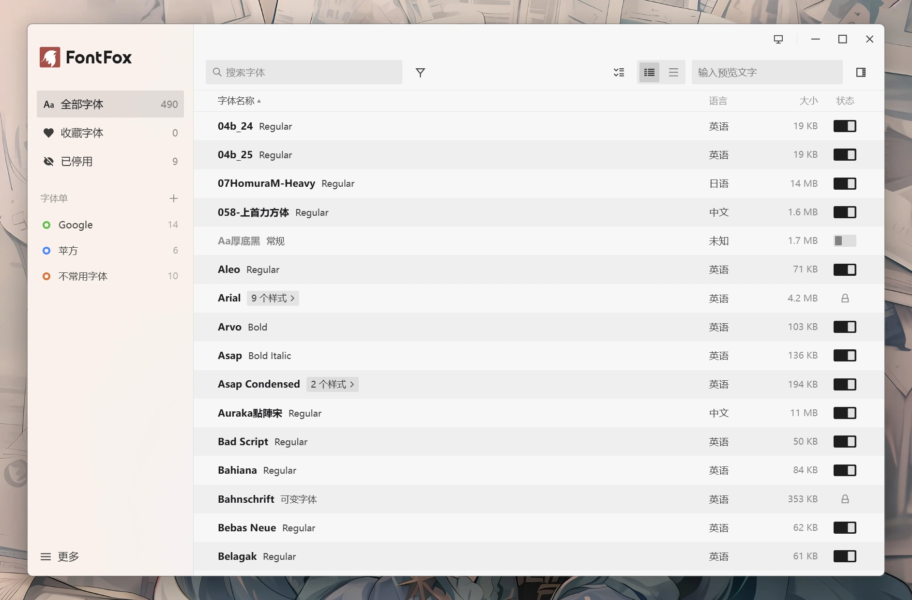
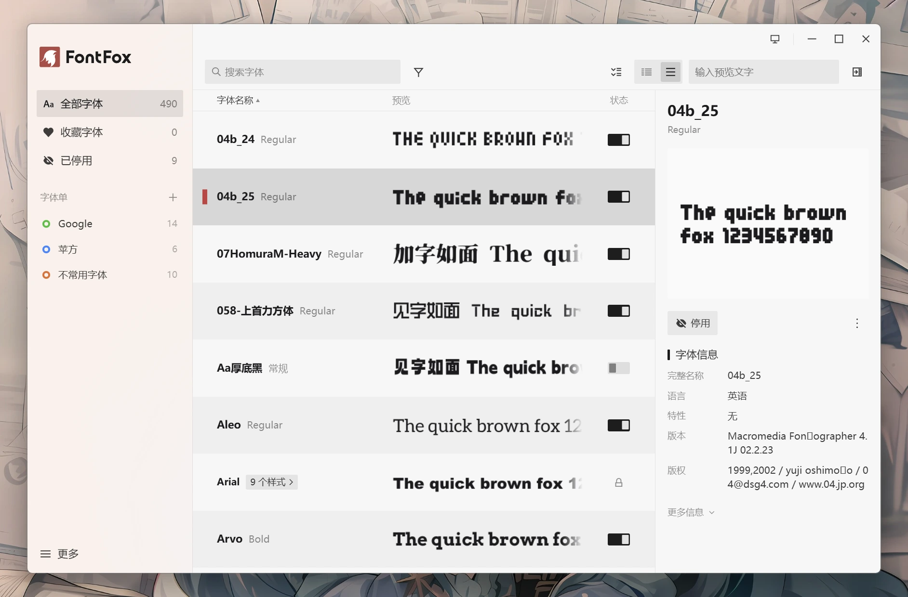

<div align="center">


# FontFox
### A fast, smooth, and easy-to-use local font manager

Made with ❤️ by [羽梦千景 Raku Inkyetta](https://github.com/AomiRaku)


[简体中文](README.md) | English

</div>

## Quick Start

Download the latest release [here](https://github.com/AomiRaku/font-fox/releases/latest).

You can also build FontFox from source.

## Overview

FontFox is a **local font manager for Windows**. It lets you **browse fonts**, **preview type**, **inspect font details**, **delete fonts**, and **quickly disable or enable fonts**.

You can **search** and **filter** fonts, or **group** them by type. Protected system fonts are marked separately.

The interface is available in Simplified Chinese, Traditional Chinese, English, French, Russian, Japanese, and Korean, and follows the system language by default.

Create favorites or **font collections** to manage fonts in groups and view them together. You can also quickly enable or disable every font in a collection.

By default, FontFox disables fonts by temporarily uninstalling them. This lets Adobe and other third-party applications refresh their font lists without a restart where possible. Windows' built-in font hiding method is also available as an option, but it has no effect in most third-party applications.

## Features

FontFox includes the following features:

- Browse and preview fonts, mark favorites, inspect font details, delete fonts, and quickly disable or enable fonts.
- Search, filter, and group installed fonts.
- Create font collections for categorized font management.
- Detect font registrations whose font files are missing.
- Check for application updates automatically, with GitHub and GitHub mirror sources selectable in Settings.

Screenshots:





## System Requirements

**Windows 11** is recommended.

Windows 10 version 1809 (64-bit) or later is required.

## Repository Structure

```
src/                Frontend: main.ts entry point, virtual list, row rendering, details, menus, i18n, etc.
src/assets/icons/   Directory for custom icon extensions
src-tauri/src/      Rust: enumeration, parsing, protection rules, hiding/deletion, elevation, settings, and library storage
src-tauri/src/data/ Bundled system font lists (system_fonts.json / core_fonts.json)
langBuild/          Source language packs (copied to lang/ next to the executable at build time)
docs/               UI specification, architecture notes, development docs, screenshots
tools/              Language-pack copying, third-party license generation, design parsing scripts
```

## Languages

Built-in languages: Simplified Chinese, English (US), French, Russian, Japanese, Korean, and Traditional Chinese (Hong Kong / Taiwan / Macau / Classical). FontFox follows the system language by default. Language files are stored in the `lang` folder next to the application and can be extended with additional translations.

## Developers

- For detailed development documentation, see the [FontFox Development Guide](docs/development.md).
- For architecture details, see the [FontFox Architecture Notes](docs/architecture.md).
- For UI specifications, see the [FontFox UI Specification](docs/ui-spec.md).

## Notes

- Font management runs entirely locally. Network access is used only for update checks.
- FontFox is built with Tauri and Rust. The interface is rendered by WebView2; no browser is bundled.
- Font previews are rasterized by Rust. The frontend only caches bitmaps, so WebView never loads font files.
- If the dynamic disable mode is active when FontFox is uninstalled, all disabled fonts are restored before removal.
- FontFox is licensed under the [Apache License 2.0](LICENSE). See [NOTICE](NOTICE) for third-party components and data sources.
